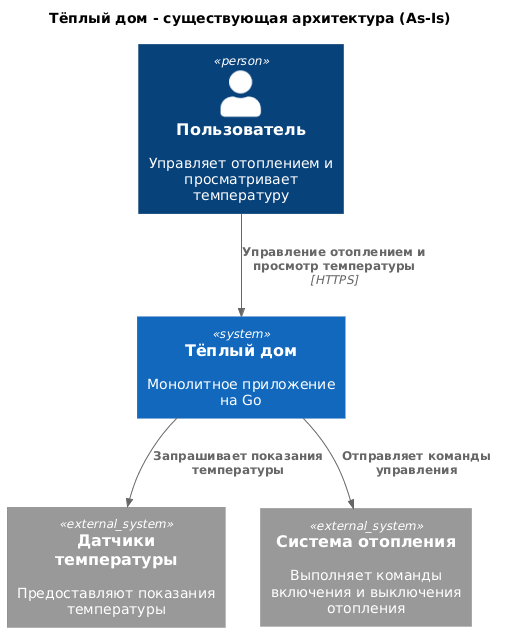
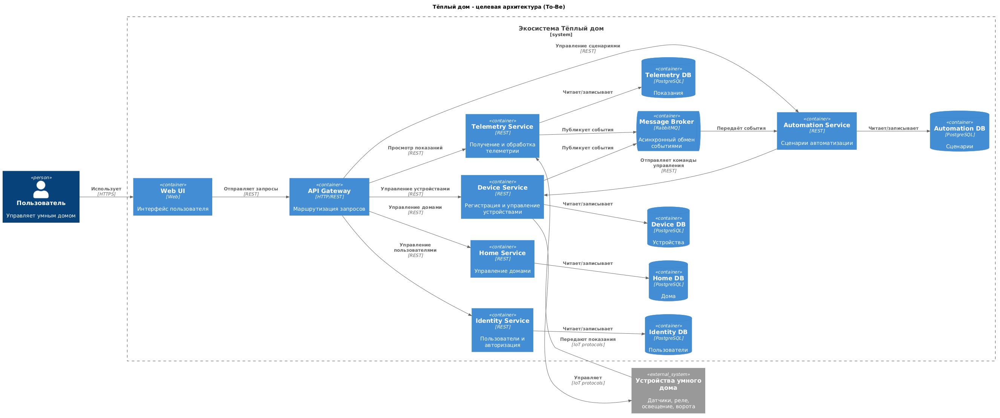

### 1. Описание функциональности монолитного приложения

**Управление отоплением:**

- Пользователи могут удалённо включать и выключать отопление в своих домах через веб-интерфейс.
- Команды управления передаются от сервера непосредственно к подключённым устройствам отопления.
- Управление доступно только для домов, подключённых специалистами компании.

**Мониторинг температуры:**

- Система получает показания температуры от датчиков, установленных в домах.
- Пользователи могут просматривать текущую температуру через веб-интерфейс.
- Получение показаний осуществляется по запросу сервера к датчику.

**Подключение устройств:**

- Подключение оборудования выполняется специалистами компании.
- Пользователи не могут самостоятельно регистрировать и подключать новые устройства.

### 2. Анализ архитектуры монолитного приложения

Существующее приложение реализовано на языке Go и использует PostgreSQL
для хранения данных.

Архитектура приложения монолитная: обработка пользовательских запросов,
бизнес-логика управления отоплением, мониторинг температуры и работа
с базой данных реализованы в рамках одного приложения.

Взаимодействие между компонентами синхронное.

Основные особенности:

- Единое приложение для всех бизнес-функций.
- Общая база данных PostgreSQL.
- Синхронная обработка запросов.
- Централизованное развёртывание.
- Отсутствие независимого масштабирования отдельных компонентов.
- Для внесения изменений требуется развёртывание всего приложения.

### 3. Определение доменов и границы контекстов

На основании анализа предметной области выделены следующие домены
и ограниченные контексты (Bounded Contexts).

- Управление пользователями (Identity & Access).
   Регистрация, аутентификация, авторизация и управление правами доступа.

- Управление домами (Home Management).
   Хранение информации о домах и управление доступом пользователей.

- Управление устройствами (Device Management).
   Регистрация, подключение и управление устройствами умного дома.

- Мониторинг и телеметрия (Telemetry).
   Получение, хранение и предоставление показаний датчиков.

- Автоматизация (Automation).
   Настройка сценариев автоматического управления устройствами.

Выделение ограниченных контекстов позволит разделить ответственность
между будущими микросервисами и снизить связанность компонентов системы.

### **4. Проблемы монолитного решения**

- Ограниченная масштабируемость. Невозможно независимо увеличивать
   вычислительные ресурсы для отдельных функциональных компонентов.

- Высокая связанность. Изменения в одной части приложения могут
   повлиять на работоспособность других частей.

- Сложность развёртывания. Обновление отдельной функции требует
   пересборки и развёртывания всего приложения.

- Низкая отказоустойчивость. Ошибка в одном компоненте потенциально
   влияет на доступность всего приложения.

- Сложность расширения функциональности. Добавление новых типов
   устройств и сценариев автоматизации усложняет монолит.

- Ограниченная гибкость интеграции. Существующая система ориентирована
   преимущественно на управление отоплением и не обеспечивает
   самостоятельное подключение пользователями новых устройств.


### 5. Визуализация контекста системы — диаграмма С4



# Задание 2. Проектирование микросервисной архитектуры

В этом задании вам нужно предоставить только диаграммы в модели C4. Мы не просим вас отдельно описывать получившиеся микросервисы и то, как вы определили взаимодействия между компонентами To-Be системы. Если вы правильно подготовите диаграммы C4, они и так это покажут.

**Диаграмма контейнеров (Containers)**

Добавьте диаграмму.

**Диаграмма компонентов (Components)**



**Диаграмма кода (Code)**

Добавьте одну диаграмму или несколько.

# Задание 3. Разработка ER-диаграммы

Добавьте сюда ER-диаграмму. Она должна отражать ключевые сущности системы, их атрибуты и тип связей между ними.

# Задание 4. Создание и документирование API

### 1. Тип API

Укажите, какой тип API вы будете использовать для взаимодействия микросервисов. Объясните своё решение.

### 2. Документация API

Здесь приложите ссылки на документацию API для микросервисов, которые вы спроектировали в первой части проектной работы. Для документирования используйте Swagger/OpenAPI или AsyncAPI.

# Задание 5. Работа с docker и docker-compose

Перейдите в apps.

Там находится приложение-монолит для работы с датчиками температуры. В README.md описано как запустить решение.

Вам нужно:

1) сделать простое приложение temperature-api на любом удобном для вас языке программирования, которое при запросе /temperature?location= будет отдавать рандомное значение температуры.

Locations - название комнаты, sensorId - идентификатор названия комнаты

```
	// If no location is provided, use a default based on sensor ID
	if location == "" {
		switch sensorID {
		case "1":
			location = "Living Room"
		case "2":
			location = "Bedroom"
		case "3":
			location = "Kitchen"
		default:
			location = "Unknown"
		}
	}

	// If no sensor ID is provided, generate one based on location
	if sensorID == "" {
		switch location {
		case "Living Room":
			sensorID = "1"
		case "Bedroom":
			sensorID = "2"
		case "Kitchen":
			sensorID = "3"
		default:
			sensorID = "0"
		}
	}
```

2) Приложение следует упаковать в Docker и добавить в docker-compose. Порт по умолчанию должен быть 8081

3) Кроме того для smart_home приложения требуется база данных - добавьте в docker-compose файл настройки для запуска postgres с указанием скрипта инициализации ./smart_home/init.sql

Для проверки можно использовать Postman коллекцию smarthome-api.postman_collection.json и вызвать:

- Create Sensor
- Get All Sensors

Должно при каждом вызове отображаться разное значение температуры

Ревьюер будет проверять точно так же.


